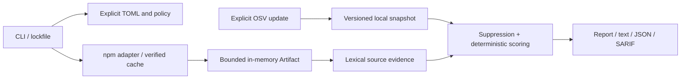

# Architecture

The runtime is `src/supply_chain_sentinel`, with one coordination path. `models.py` owns typed evidence and result structures. `config.py` validates explicit TOML and expiring suppressions. `adapters/npm.py` handles exact npm identifiers, strict public-registry URLs, strongest-supported SRI verification, atomically written content-addressed archives and exact-identity indexes. `archive.py` reads bounded gzip tar content in memory, rejects dangerous members, and never writes package paths. Its source-tree digest differs from the raw archive digest and is marked accordingly.

`rules.py` performs deterministic, bounded lexical inspection of JS/TS/shell and package manifests. It strips comments with a lexical approximation, retains strings, and checks nearby capabilities. It is neither a complete parser nor a data-flow engine. Literal base64 decoding has length/count limits and does not evaluate code. `.json` files are retained for manifests, but arbitrary JSON strings are not scanned as executable JS. No native binary or Python source claims are made.

`feeds.py` queries exact versions through OSV, follows pagination, ignores withdrawn records and atomically replaces selected entries. A snapshot contains a schema version, source URL, generated time, per-identity query time, digest and advisory provenance. The digest detects corruption, not malicious replacement. Unknown/new/withdrawn advisories are reflected only after a successful update. Snapshots are intentionally a selected-identity cache rather than a full OSV database mirror. Concurrent updates to one cache should be serialized by the caller.

`scanner.py` connects acquisition, rules, advisory coverage and policy. Missing/stale advisory data is visible as a warning or a hard error with `--require-advisories`; source parsing or acquisition failures always produce `error`. `lockfile.py` retains exact versions and SRI. A shared scanner is read-only except for atomic content-addressed cache writes, so concurrent scans do not share extraction directories. `output.py` escapes terminal controls, serializes reports, and maps SARIF findings to repository lockfiles rather than non-existent registry source files.

## Policy

Per-rule contributions use info=0, low=5, medium=20, high=55, critical=100, multiplied by evidence confidence, capped once per rule and 100 overall. This is a transparent heuristic, not a learned/calibrated probability. A score >=40 means `review`. An unsuppressed known-malicious advisory means `blocked`. Name similarity alone is a low-confidence hint. A `clean` result means no threshold-level signal, with lower-level findings still visible. No popular-package exemption or mass directory-based downgrade exists.

Exit-code precedence is errors (2), then policy failures (1), then success (0). `never` disables policy failure, not errors. `blocked` supports advisory-only gating while retaining heuristic warnings. A source-only scan does not establish complete advisory coverage or runtime safety. Identity-only mode explicitly omits source analysis.

## Adapter growth

`EcosystemAdapter` is an explicit Protocol, not automatic plugin discovery. New ecosystems implement exact identity/acquisition and format-specific lockfiles and archives; shared reports/policy/output remain. No arbitrary downloaded code or untrusted plugin entry points are imported. PyPI is the next candidate after npm evidence/maintenance gates; extensions need distinct permissions/API analysis.

A fresh exact-version known-malicious record can block before source acquisition, including registry versions that have been removed. That report explicitly says `not-scanned (known-malicious identity)` and contains no archive digest. Expired/missing data does not become an implicit fresh match. Identity-only lookup remains a separate explicit mode.
